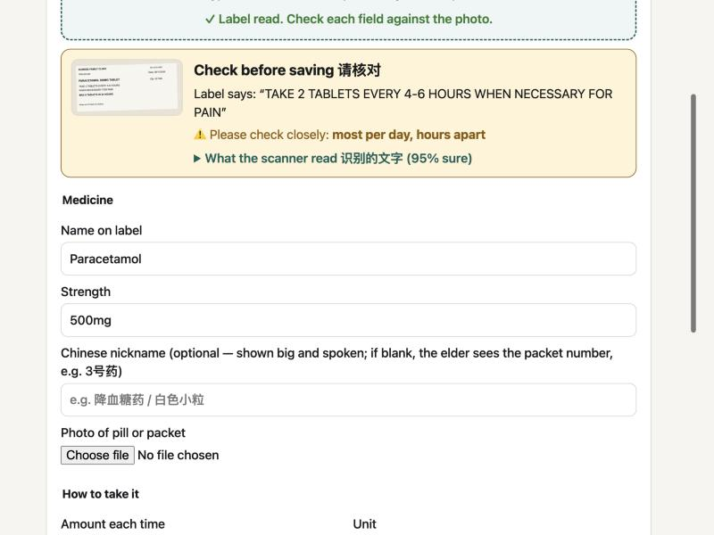
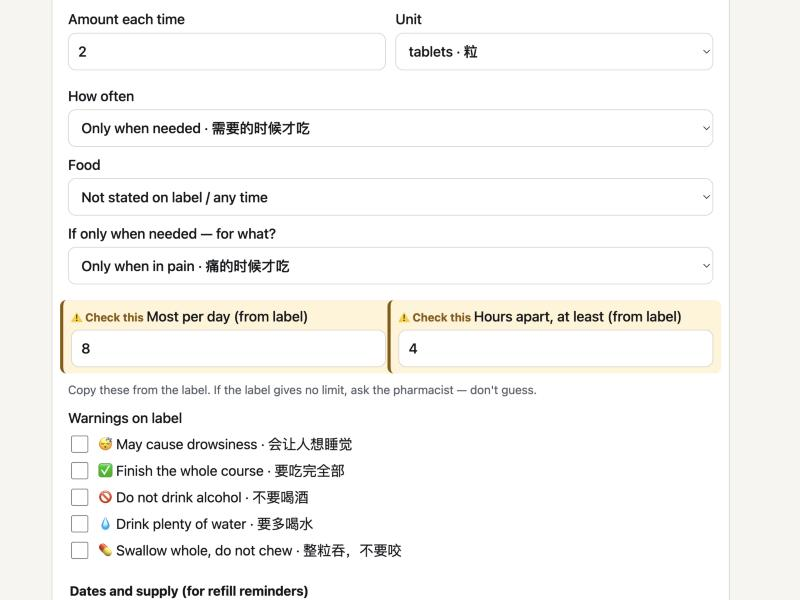
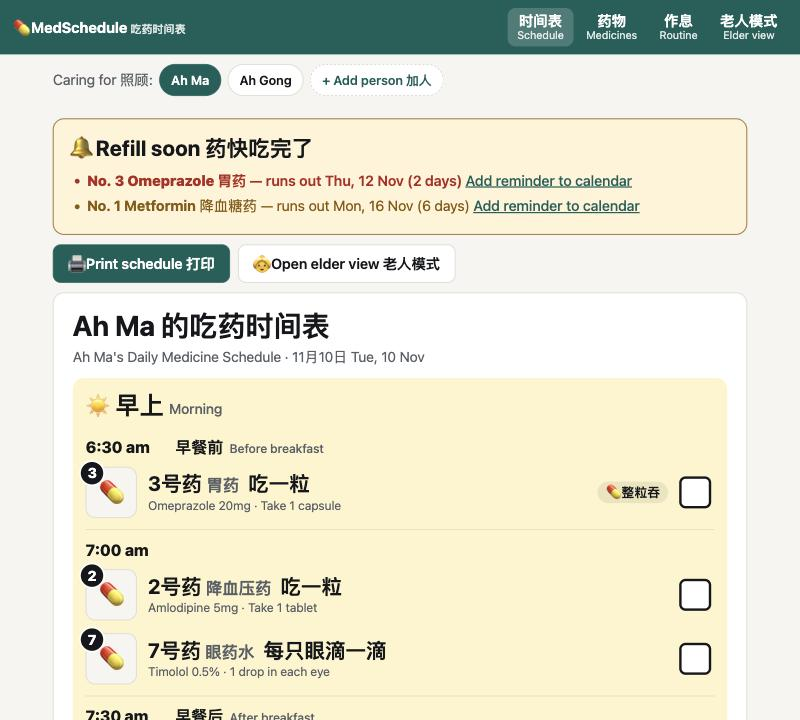
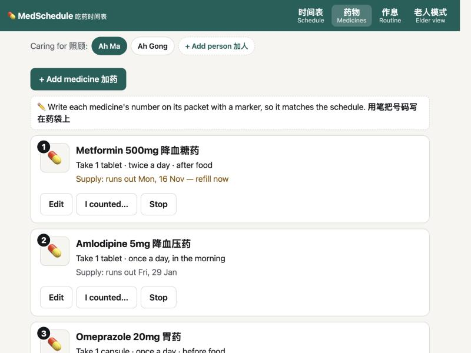
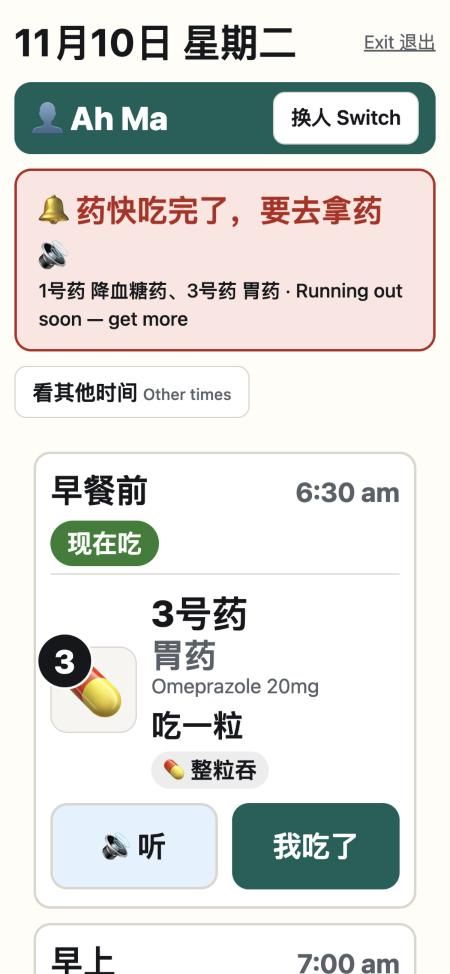
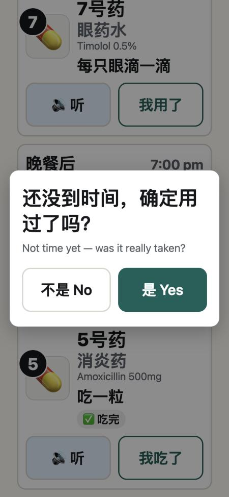
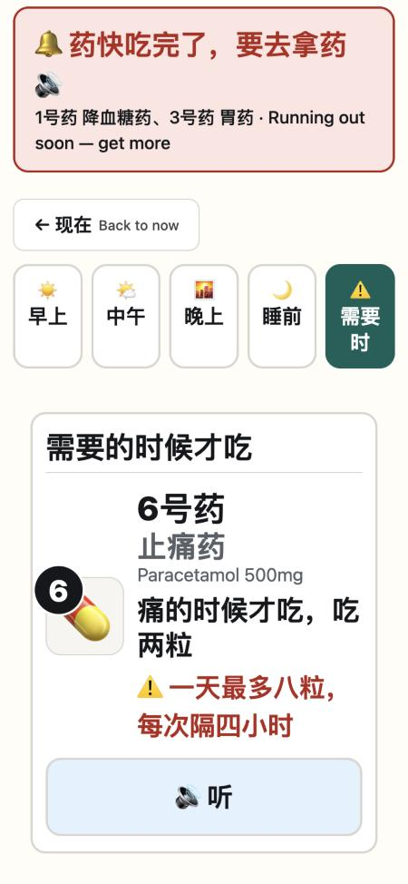

# MedSchedule 吃药时间表: Introduction

- **Live prototype:** https://evanyilun-byte.github.io/medschedule/ (works on any phone or computer, no sign-in; press **Load example patient** to try it)
- **Source code:** https://github.com/evanyilun-byte/medschedule
- **Full prompt history:** [docs/prompt-log.md](docs/prompt-log.md)

---

## 1. The healthcare pain point

In Singapore, medicine labels from polyclinics, GP clinics, hospitals and pharmacies are almost always printed **in English only**, and the instructions are often vague or abbreviated: "1 tab BD pc", "twice daily, after food", "take when necessary".

Many older Singaporean patients, especially those who grew up reading Chinese, **cannot read these labels**. They depend on someone else to tell them what each medicine is and when to take it. That causes three problems:

1. **Translation is done by hand, over and over.** Caregivers write Chinese notes on every packet, and rewrite them every time a long-term medicine is refilled.
2. **Instructions stay vague.** "Twice daily after food" still has to be turned into actual times, and different family members may do it differently.
3. **Medicines from several clinics never come together.** An elder seeing a polyclinic, a specialist and a GP ends up with separate packets and no single picture of their day.

The risk is missed doses, double doses, or the wrong medicine taken at the wrong time.

## 2. Who experiences it

| Who | Their problem |
|---|---|
| **Older patients** who read Chinese but not English | Cannot read their own labels; rely on memory or on others |
| **Family caregivers** (adult children) | Spend time translating and handwriting, often for both parents, and worry about mistakes |
| **Domestic helpers** | Often the person actually giving the medicines, but they usually read English, not Chinese, so the elder and helper can't share one set of notes |
| **Clinics and pharmacists** | Their careful instructions lose meaning once the packet reaches a home where nobody can read them |

## 3. How the prototype addresses it

MedSchedule turns a person's medicine labels, from any clinic, into **one large-print, bilingual (English + 简体中文) daily schedule**, with a simple phone screen the elder can use alone.

### For the caregiver

**Scan the label (free, on the phone).** The caregiver photographs a label. The text is read on the phone itself (Tesseract.js), so the photo never leaves the device and nothing is paid for. A rule-based reader then understands Singapore label wording ("TAKE 1 TABLET(S) 2 TIME(S) A DAY AFTER FOOD", BD / TDS / PC, "MAX 8 TABS IN 24 HOURS"…). Anything it is unsure of is highlighted, and **nothing is saved until the caregiver ticks "I have checked every detail against the label"**.

| Scan review: what the label says, what was read, what to double-check | Unsure fields highlighted; limits only from the label |
|---|---|
|  |  |

**One schedule, translated and timed.** The caregiver enters the elder's meal and bed times once, so "twice daily after food" becomes "早餐后 7:30 am / 晚餐后 7:00 pm". All Chinese comes from a fixed, reviewable phrase list. **Nothing is machine-translated**, so the same label always gives the same Chinese. The schedule can be printed for the fridge. Refill reminders appear before a medicine runs out.

**Packet numbers instead of handwriting.** Each medicine gets a number. The caregiver writes it on the packet with a marker. The same number is on the elder's screen, the printout and the audio, so the elder matches a number rather than reading a drug name. Numbers are never reused, so a marked packet always stays correct.

### For the elder

| Shared phone: "Who are you?" | Shows only what to take now | Confirms before an early tick | "When needed" medicines show their limit |
|---|---|---|---|
|  |  |  |  |

- The elder view reads the clock and shows **only the medicines for now**, marked **现在吃 (take now)** or **还没到时间 (not yet)**, and keeps itself up to date.
- Each card is titled by its **number** ("3号药"), then an optional Chinese nickname (胃药), then what to do with the right verb (吃 tablets, 喝 liquids, 滴 drops with which eye, 吸 inhalers).
- **🔊 听** reads it aloud in Mandarin: "三号药，胃药，早餐前，吃一粒".
- **我吃了 / 我用了** ticks it off. Early ticks and unticks ask first, in large type.
- Doses not ticked are reported as information only. The app never tells anyone to take a missed dose late.
- Several people can share one phone (e.g. Ah Ma and Ah Gong). A bilingual mode helps helpers who read English.

### Key safety decisions

- **No pre-filled guesses.** Unknown fields stay blank and must be chosen, because a wrong pre-filled value looks exactly like a right one.
- **Limits only from the label.** For "when needed" medicines, the maximum per day and hours apart come from the label or the caregiver. The app never suggests a number.
- **Caregiver review is compulsory** for every scanned label.
- **All data stays on the phone**: no accounts and no server.

### Testing and limitations

- **120 automated tests** cover the scheduling, refill maths, label reading and safety rules (all passing; run them at [/tests/](https://evanyilun-byte.github.io/medschedule/tests/)).
- The scanner was tested on computer-generated labels, including tilted, noisy two-column "photo-style" ones. I also tried it on real label photos, which found a bug (medicine names not filling) that was then fixed.
- **Limitations:**
  - Curved packets, glare and handwriting read poorly.
  - Data does not sync between phones.
  - The Chinese phrase list still needs review by a native speaker or pharmacist.
  - It has not been tested with real elderly users yet.
  - It is an aid, not medical advice.

---

## 4. How I prompted and guided the coding agent

I built MedSchedule with **Claude Code**, through its desktop app. I set the direction, make the decisions, push back, and test. The full list of my prompts is in [docs/prompt-log.md](docs/prompt-log.md). I asked the agent to keep it from the very first message.

### My approach

1. **Start from the problem, not the solution.** My first real prompt described the pain point and the users and asked *"How do you suggest we build this"*, rather than naming a technology.
2. **Plan before code.** I asked to refine the plan first. The agent asked me four questions (purpose, input method, users, language), and my answers shaped the plan: a school/portfolio project, photo input, caregiver *and* elder users, Simplified Chinese with audio.
3. **Ask for an evaluation before building.** For most new ideas I asked the agent to evaluate them first and tell me the trade-offs, e.g. *"evaluate if adding the stickers and voice recording will overcomplicate the app"*, or *"for 1, whats the trade off? does it make things a lot more complicated or does it take up battery"*. Only then did I say "build".
4. **Ask for pushback explicitly.** For my safety fixes I wrote *"tell me your pushbacks if any, before you build"*. That produced better versions of my own ideas (see below).
5. **Test it myself and report what I saw.** I used the live app and real label photos, and reported problems in plain words: *"im testing the app now on real pictures, its not auto-filling the name of the medicine"*.
6. **Keep the project focused.** Several times I chose the simpler path to keep the app finishable.

### How the result was refined

| What I asked or noticed | What changed |
|---|---|
| The plan used Next.js, but Node.js wasn't installed on my laptop | Switched to plain HTML/JavaScript with no build step, which also allowed free hosting on GitHub Pages |
| *"for a project, i dont think it should be paid… is there other ways"* | Replaced the paid AI label reader with free on-device text reading plus a rule-based parser (the AI version stays in the repo as an option) |
| *"what if… it appears automatically on the caregivers phone"* (dose tracker) → *"do you think this will become a bit too complicated"* → *"nevermind lets keep to the original plan"* | Tracker moved to "future ideas" instead of half-building a server |
| Stickers → *"most families do not have a sticker printer"* | Replaced with **packet numbers** written with a marker |
| *"the UI looks abit cluttered… evaluate the idea of colour coding"* | The agent argued colour-per-medicine would clash with the time-of-day colours and is hard for ageing eyes. We decluttered instead, grouping doses by time. |
| *"do you think we should still include the english version for the elderly view?"* | Chinese-first, with a small English drug name for clinic visits, plus a "bilingual version" setting I named for helpers |
| *"what if we can have different routines/medicines for different patients"* | Profiles, a "Who are you?" picker for shared phones, and numbers unique across the household |
| *"so the patient does not need to toggle between morning and night"* | An automatic "Now" screen. I asked about complexity and battery first, then *"build it with the 3 rules"* so the screen never jumps while being used. |
| My four safety fixes (eye drops said "吃" (eat), pre-filled defaults, no maximum for when-needed medicines, early ticks) | Built with the agent's refinements: drops also need *which eye*; the manual form is blank too; limits never suggested; early ticks confirmed rather than blocked |
| *"this doesnt translate, it still requires users to manually key in"* → *"what about the numbers"* → *"build numbers first"* | Every card is titled by its number; the nickname is optional; the audio never tries to pronounce English |

### How I checked the agent's work

- I asked for **automated tests** for the logic (now 120) and for the agent to **check every change in a browser**, at phone size, before pushing.
- The agent found and fixed bugs in its own testing (e.g. medicine numbers being reused after a deletion, and the screen-update rule breaking when the phone's clock changes). I found others by using the app (the medicine name not filling on real photos).
- The agent pushed every change to GitHub and confirmed the live site's tests passed.
- I kept decisions that affect safety for myself, such as whether to block or confirm early ticks, and whether the audio should keep the nickname.

### What I'd do next

Test with 3–5 elder and caregiver pairs, measure scanning accuracy on about 30 real labels, have a native speaker or pharmacist review the Chinese phrases, and make the app installable and offline. The longer-term vision (accounts, phone reminders, links to GPs) is described in the roadmap.
